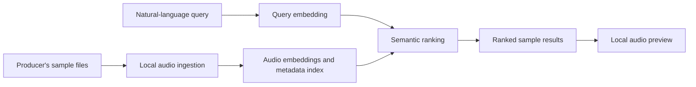

# Architecture overview

Sample Scout is designed around a simple privacy boundary: a producer's library is indexed and searched in their own environment.

## Main pieces

| Component | Responsibility |
| --- | --- |
| Local audio ingestion | Reads supported audio formats and records metadata for a producer's library. |
| Semantic index | Represents the musical and sonic characteristics of each sample for similarity search. |
| Query and ranking | Converts a producer's description into a search query and ranks likely matches. |
| Desktop interface | Lets producers search, inspect, and preview results without sending their library to a public catalog. |

## Privacy note

The architecture intentionally keeps a producer's private sample collection separate from the public demo experience. The public demo uses only licensed demonstration audio and exposes no user-uploaded library content.

