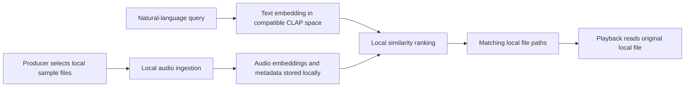

# Architecture overview

Sample Scout's macOS technical preview searches a producer's selected sample library locally. The public site is a static product page and does not provide remote search.

## Main pieces

| Component | Responsibility |
| --- | --- |
| Local audio ingestion | Reads supported audio files selected from the producer's Mac and records their metadata. |
| Local index | Stores audio embeddings and metadata on the Mac for similarity search. |
| Query and ranking | Embeds a text description in a compatible CLAP space and ranks local matches. |
| Desktop interface | Lets producers search, inspect, and preview matching files from their original local paths. |

## Privacy and model downloads

Sample indexing, text search, similarity ranking, and playback operate locally. Sample audio is not uploaded to a remote service. The application downloads model files on first use, so an internet connection is needed for that initial download.
